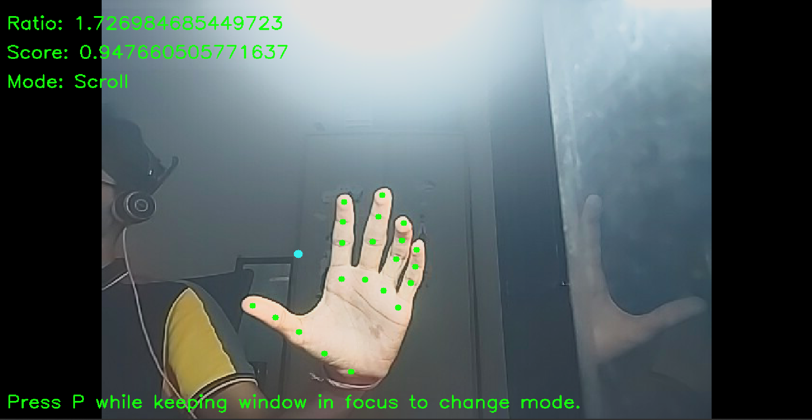
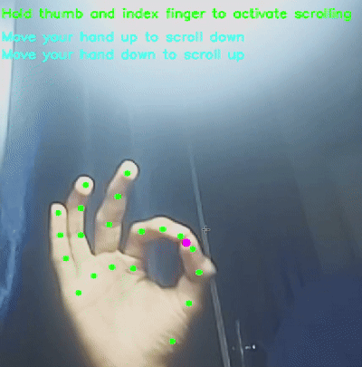
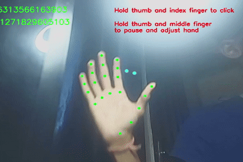
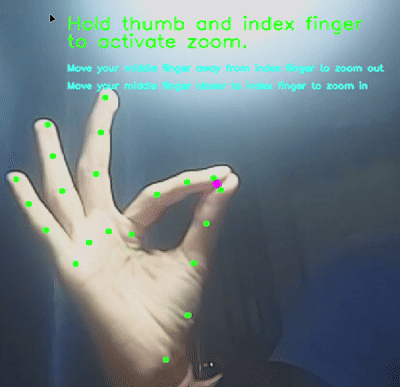

# Lazy Control

**Lazy Control allows you to easily control your pc with hand guestures. It provides with Scrolling, Mouse and Zoom functionality**

  

**For optimal experience ensure that the hand is well lit with no shadows on it. There should not be more than one hand in the frame.**

# Guesture Modes
## Scroll
To scroll, you must **bring your thumb and index fingers in contact** and then **move your hand up and down**.

  

## Mouse
In mouse mode the mouse cursor moves with the **Mid point of your thumb and index finger**. You **tap the index finger and thumb to click** and you **hold the thumb and middle finger to stop movement** if you may want to adjust your hand.

  

## Zoom
In zoom mode, you must **keep the thumb and index finger in contact** and then **zoom by moving the middle finger closer or far away from your thumb**.

**It uses the keybard shortcuts `ctrl + +` and `ctrl + -` to zoom in and zoom out**

  

# Configuration
You can edit the following variables at the top of the code -
 - scroll_sensitivity => sensitivity for scrolling
 - sensitivity => sensitivity for mouse movement
 - scroll_small_movement => min threshold for scrolling 
 - small_movement => min threshold for moving mouse
 - ti_tap_threshold => threshold to consider thumb and index finger in contact
 - tm_tap_threshold => threshold to consider thumb and middle finger in contact

**Also you can press "p" to switch between the modes while having the window in focus.**